## 2. XAMPPの導入

### 2-1. XAMPPとは

XAMPP（ザンプ）は、Webアプリケーションの開発に必要なソフトウェアをまとめてインストールできるツールである。

通常、Webアプリケーションを動作させるためには、WebサーバーやPHP、データベースなどをそれぞれ準備する必要がある。

XAMPPを使用することで、これらのソフトウェアをまとめて導入できる。

XAMPPには、主に以下の機能が含まれている。

| 機能 | 役割 |
|---|---|
| Apache | Webページをブラウザに配信するWebサーバー |
| MariaDB | データを保存・管理するデータベース |
| PHP | Webアプリケーションの処理を実行する |
| phpMyAdmin | ブラウザからデータベースを管理するツール |

今回は、CakePHPを使用したWebアプリケーション開発のためにXAMPPを導入する。

### 2-2. XAMPPのダウンロード

#### 手順1：公式サイトにアクセスする

Webブラウザを起動し、XAMPPの公式サイトにアクセスする。

公式サイト：https://www.apachefriends.org/jp/index.html

#### 手順2：Windows版を選択する

公式サイトから「Windows向けXAMPP」を選択する。 
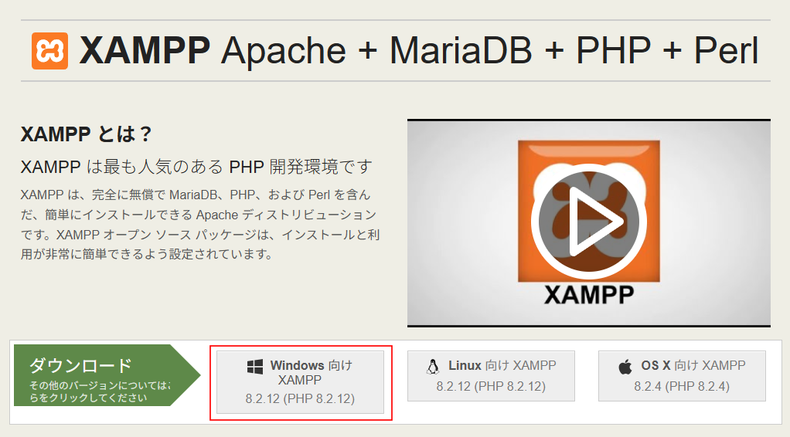

#### 手順3：バージョンを確認する

今回使用するバージョンは以下のとおりとする。

| 項目 | 内容 |
|---|---|
| ソフトウェア | XAMPP |
| バージョン | 8.2.12 |
| 対応OS | Windows |
| PHP | 8.2.12 |

※ 使用バージョンは暫定であり、正式決定後に修正する。

公式サイトに対象バージョンが表示されない場合は、以下の配布ページを確認する。

https://sourceforge.net/projects/xampp/files/XAMPP%20Windows/

ダウンロードするファイル名の例：

`xampp-windows-x64-8.2.12-0-VS16-installer.exe`

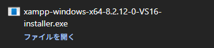

#### 手順4：ダウンロードする

目的のインストーラーを選択し、ダウンロードする。

ダウンロード完了後、保存先のフォルダーにファイルが存在することを確認する。

### 2-3. インストーラーの起動

1. エクスプローラーを起動する。
2. 「ダウンロード」フォルダーを開く。
3. ダウンロードしたXAMPPのインストーラーをダブルクリックする。
4. セットアップ画面が表示されることを確認する。
5. 「Next」をクリックする。

### 2-4. 警告画面への対応

インストール中に、WindowsやXAMPPから警告画面が表示される場合がある。

#### ユーザーアカウント制御（UAC）

Windowsから「このアプリがデバイスに変更を加えることを許可しますか？」と表示される場合がある。

発行元や入手先を確認し、正規のインストーラーであることを確認してから「はい」を選択する。 
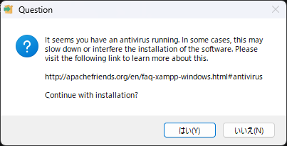

#### XAMPPの警告

XAMPPのインストール時に、UACの影響で一部の機能が制限される可能性があるという警告が表示される場合がある。

特に、`C:\Program Files` へのインストールはアクセス権限の影響を受ける場合がある。

今回は `C:\xampp` にインストールするため、内容を確認して「OK」をクリックする。

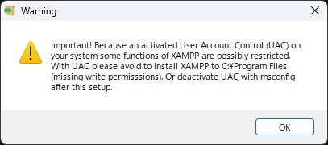

※ UAC機能を無効化する必要はない。

### 2-5. インストールする機能の選択

セットアップ中に「Select Components」という画面が表示される。 
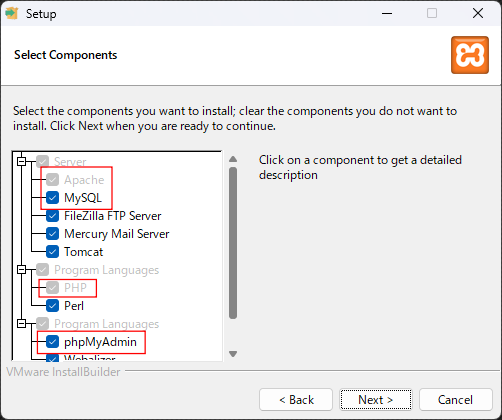

ここでは、インストールする機能を選択する。

今回の開発環境で必要な主な機能は以下のとおり。

| 機能 | 選択 |
|---|---|
| Apache | 必要 |
| MySQL（MariaDB） | 必要 |
| PHP | 必要 |
| phpMyAdmin | 必要 |

基本的には初期状態のチェックを変更せずに進める。

必要な機能が選択されていることを確認し、「Next」をクリックする。

### 2-6. インストール先の設定

インストール先のフォルダーを設定する。 
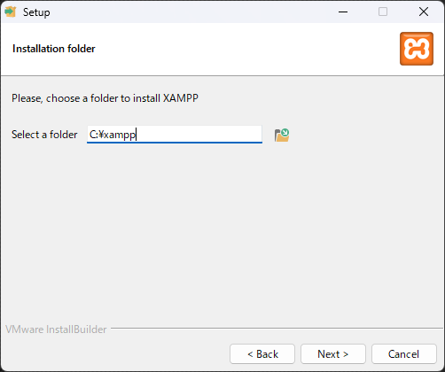

今回は以下のフォルダーを使用する。

`C:\xampp`

`C:\xampp` は、Cドライブ直下にあるXAMPP専用のフォルダーである。

`C:\Program Files` など、Windowsのアクセス制御の影響を受けやすいフォルダーは避ける。

インストール先を確認し、「Next」をクリックする。

途中で言語選択画面や案内画面が表示された場合は、内容を確認して進める。 
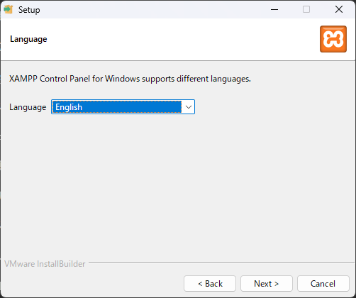

### 2-7. インストールの実行

#### 手順1：インストールを開始する

セットアップを進め、インストール準備完了画面で「Next」をクリックする。 
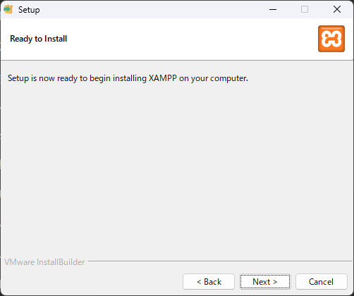

#### 手順2：インストール完了まで待つ

インストールが開始されると、必要なファイルが指定したフォルダーに展開される。 
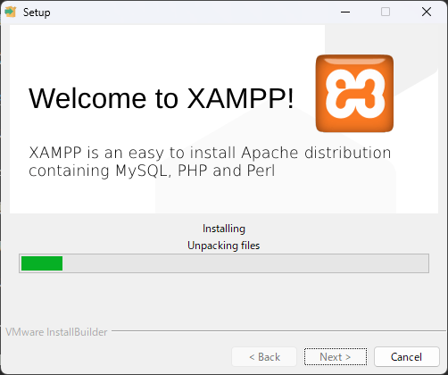

処理が完了するまで待つ。

#### 手順3：セットアップを終了する

インストール完了画面が表示されたら、「Finish」をクリックする。 
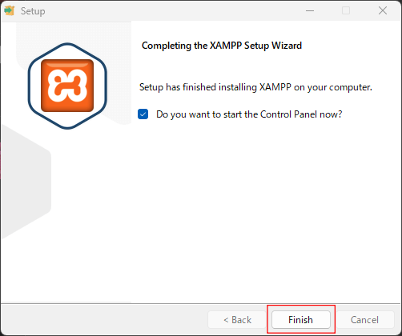 
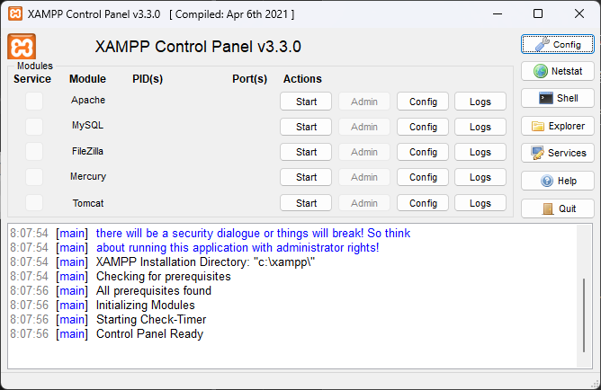

XAMPP Control Panelを起動するか確認する項目が表示された場合は、必要に応じてチェックを入れる。