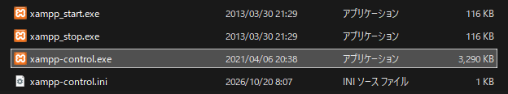
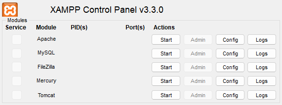
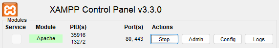
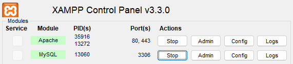
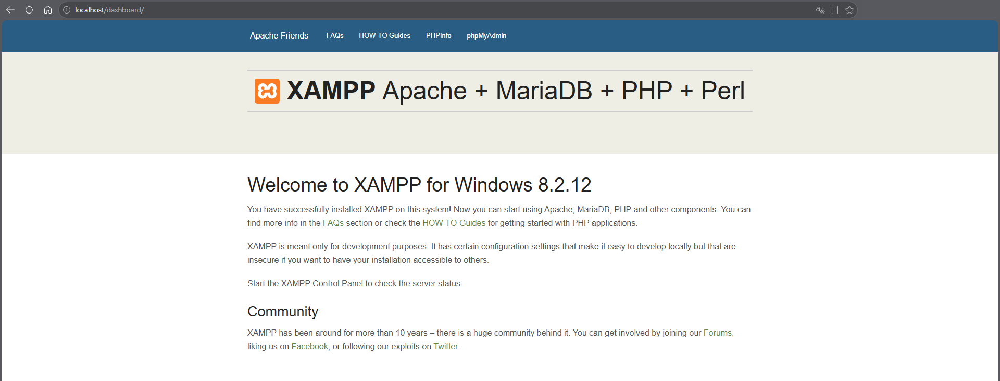
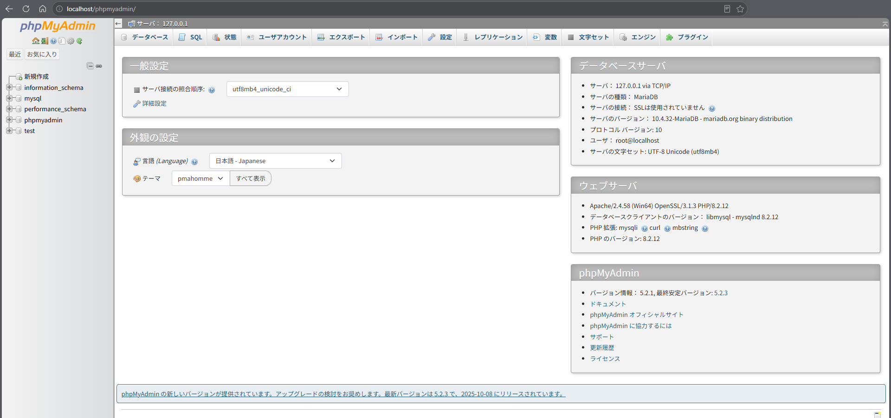

## 3. XAMPPの動作確認

XAMPPのインストールが完了したら、ApacheとMySQL（MariaDB）が正常に動作するか確認する。

また、WebブラウザからXAMPPの初期画面とphpMyAdminにアクセスし、開発環境が利用できる状態になっているか確認する。

### 3-1. XAMPP Control Panelの起動

XAMPP Control Panelは、ApacheやMySQLなどの起動・停止を管理するためのツールである。

#### 手順1：XAMPPのフォルダーを開く

1. エクスプローラーを起動する。
2. アドレスバーに `C:\xampp` と入力する。
3. Enterキーを押す。

#### 手順2：Control Panelを起動する

`C:\xampp` 内にある `xampp-control.exe` をダブルクリックする。 

正常に起動すると、XAMPP Control Panelが表示される。

#### 手順3：管理画面を確認する

主な項目は以下のとおり。

| 項目 | 役割 |
|---|---|
| Module | ApacheやMySQLなどの機能名 |
| Start / Stop | 各機能の起動・停止 |
| Admin | 管理画面を開く |
| Config | 設定を確認・変更する |
| Logs | ログを確認する |
| Quit | Control Panelを終了する |

### 3-2. Apacheの起動

Apacheは、Webページをブラウザに配信するためのWebサーバーである。

#### 手順1：Apacheを起動する

XAMPP Control Panelの「Apache」の行にある「Start」をクリックする。

#### 手順2：起動状態を確認する

正常に起動すると、以下の状態になる。

- Apacheの行が緑色になる。
- 「Start」が「Stop」に変わる。
- PID（プロセスID）が表示される。
- 使用しているポート番号が表示される。

Apacheは通常、HTTP通信に80番、HTTPS通信に443番ポートを使用する。 

**注意：** Apacheが起動しない場合は、他のソフトウェアが同じポートを使用している可能性がある。

### 3-3. MySQLの起動

MySQLは、データを保存・管理するためのデータベース管理システムである。

XAMPPでは、MySQLと互換性のあるMariaDBが使用される。

#### 手順1：MySQLを起動する

XAMPP Control Panelの「MySQL」の行にある「Start」をクリックする。

#### 手順2：起動状態を確認する

正常に起動すると、MySQLの行が緑色になり、「Start」が「Stop」に変わる。

| 確認項目 | 正常な状態 |
|---|---|
| Apache | 緑色・Stop表示 |
| MySQL | 緑色・Stop表示 |
| エラーメッセージ | 起動を妨げるエラーがない |

MySQL（MariaDB）は通常、3306番ポートを使用する。 

**注意：** 起動に失敗した場合は、ポート番号の競合やデータベースの設定を確認する。

### 3-4. localhostへのアクセス

`localhost` は、現在使用している自分のパソコンを表すホスト名である。

Apacheを起動すると、自分のパソコンをWebサーバーとして使用できる。

#### 手順1：ブラウザを起動する

Microsoft EdgeやGoogle ChromeなどのWebブラウザを起動する。

#### 手順2：URLを入力する

アドレスバーに以下のURLを入力する。

`http://localhost/`

#### 手順3：XAMPPの画面を確認する

正常に動作している場合は、XAMPPのダッシュボード画面が表示される。 

画面が表示されれば、Apacheがブラウザからのアクセスに正常に応答していることを確認できる。

### 3-5. phpMyAdminへのアクセス

phpMyAdminは、MySQLやMariaDBのデータベースをブラウザから管理するためのツールである。

SQLを直接入力しなくても、画面上からデータベースやテーブルの作成・編集などを行える。

#### 手順1：ApacheとMySQLの起動を確認する

XAMPP Control Panelで、ApacheとMySQLの両方が起動していることを確認する。

#### 手順2：ブラウザからアクセスする

アドレスバーに以下のURLを入力する。

`http://localhost/phpmyadmin/`

#### 手順3：管理画面を確認する

正常に動作している場合は、phpMyAdminの管理画面が表示される。 

画面左側にはデータベースの一覧、中央にはサーバー情報や設定項目などが表示される。

管理画面が表示され、データベースサーバーに正常に接続できていれば確認完了となる。

#### 完了確認

以下の項目を確認する。

- [ ] XAMPP Control Panelが正常に起動する。
- [ ] Apacheが正常に起動する。
- [ ] MySQL（MariaDB）が正常に起動する。
- [ ] `http://localhost/` にアクセスできる。
- [ ] `http://localhost/phpmyadmin/` にアクセスできる。

すべての項目を満たしていれば、XAMPPの基本的な動作確認は完了となる。

次の「4. PHPの確認・設定」では、PHPのバージョンや設定を確認する。