## 4. PHPの確認・設定

XAMPPに含まれるPHPが正常に動作するか確認し、CakePHPの開発に必要な設定を行う。

今回はXAMPPに同梱されているPHPを使用するため、PHPを別途インストールする必要はない。

### 4-1. PHPとは

PHPは、Webアプリケーションの処理を実行するためのプログラミング言語である。

主に以下のような処理に使用する。

- ユーザーのログイン認証
- データベースへの情報の登録・取得
- フォームに入力された内容の処理
- Webページに表示する情報の生成

CakePHPはPHPで動作するため、PHPを正しく実行できる環境が必要となる。

### 4-2. PHPのバージョン確認

#### 手順1：コマンドプロンプトを起動する

1. Windowsのスタートメニューを開く。
2. 検索欄に `cmd` と入力する。
3. 「コマンドプロンプト」をクリックする。<br>
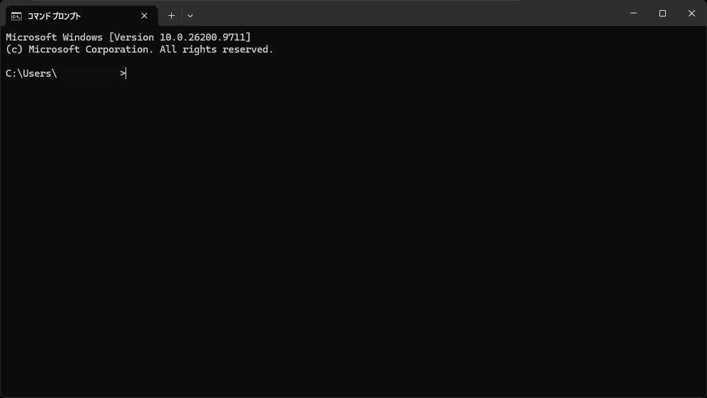

#### 手順2：PHPのバージョンを確認する

コマンドプロンプトに以下を入力する。

```cmd
C:\xampp\php\php.exe -v
```

Enterキーを押すと、PHPのバージョン情報が表示される。<br>
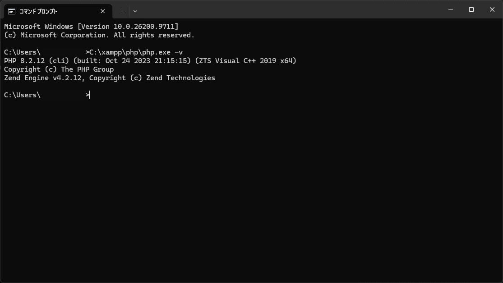

表示例：

```text
PHP 8.2.12 (cli)
Copyright (c) The PHP Group
Zend Engine v4.2.12
```

今回使用する暫定バージョンはPHP 8.2.12である。

予定しているバージョンが表示されれば、PHPがインストールされていることを確認できる。

### 4-3. 環境変数PATHの設定

環境変数PATHは、Windowsがプログラムの実行ファイルを探す場所を指定する設定である。

PATHを設定すると、PHPの実行ファイルをフルパスで指定せずにコマンドを実行できる。

#### 手順1：環境変数の設定画面を開く

1. Windowsのスタートメニューを開く。
2. 「環境変数」と検索する。
3. 「環境変数の編集」を開く。

#### 手順2：Pathを編集する

「XXXXのユーザー環境変数」にある `Path` を選択し、「編集」をクリックする。<br>
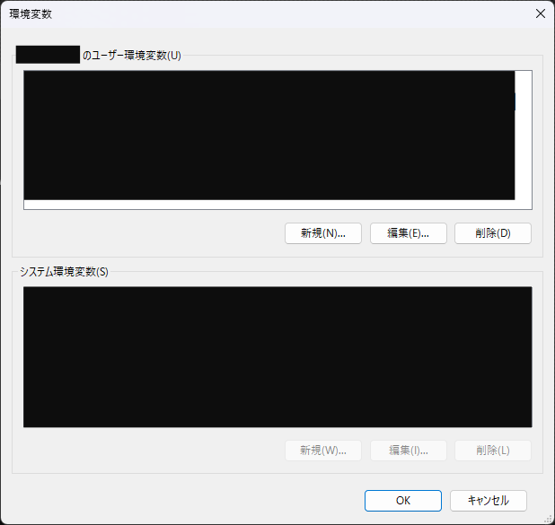

#### 手順3：PHPのフォルダーを追加する

「新規」をクリックして、以下のパスを追加する。<br>
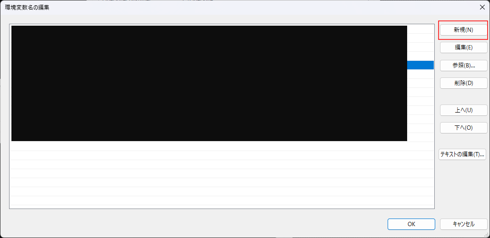

`C:\xampp\php`

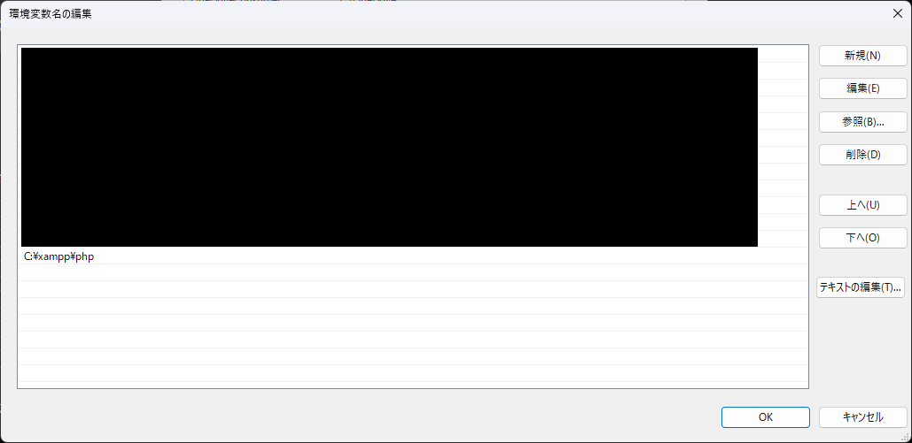

※ `php.exe` ではなく、PHPの実行ファイルが保存されているフォルダーを指定する。

既に同じパスが登録されている場合は、重複して追加しない。

#### 手順4：設定を保存する

「OK」をクリックして設定画面を閉じる。

設定後、コマンドプロンプトを一度終了してから再起動する。

#### 手順5：設定を確認する

以下のコマンドを入力する。

```cmd
php -v
```

PHPのバージョンが表示されれば、PATHが正しく設定されている。<br>
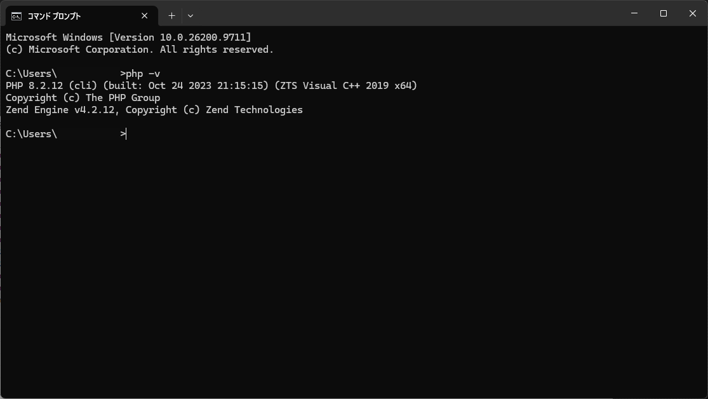

さらに、以下のコマンドでPHPの実行ファイルの場所を確認する。

```cmd
where php
```

表示例：

```text
C:\xampp\php\php.exe
```

別のPHPが表示される場合は、環境変数PATHの設定を確認する。<br>
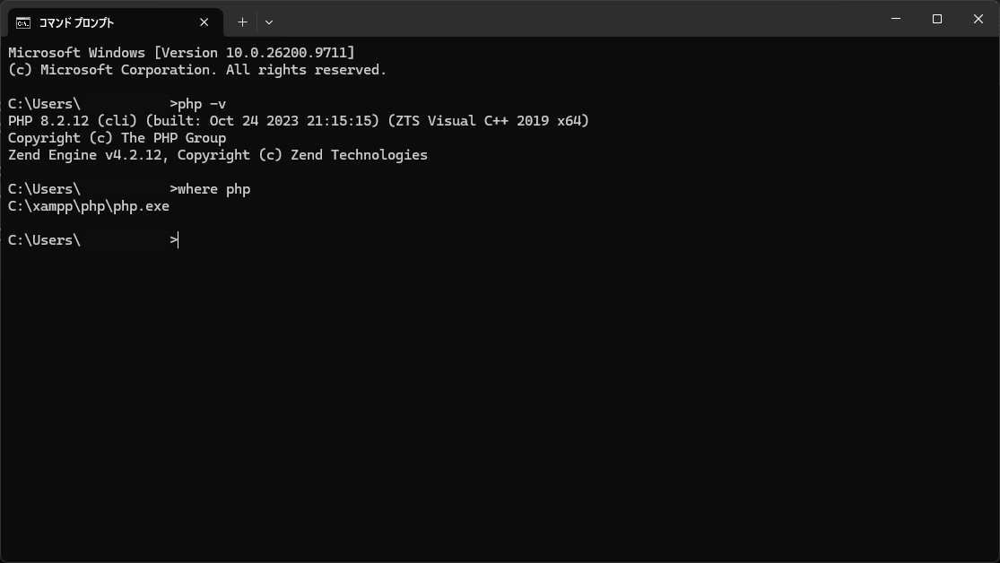

### 4-4. PHP拡張機能の確認

PHP拡張機能とは、PHPに追加の機能を提供する仕組みである。

CakePHPを動作させるためには、必要な拡張機能が有効になっている必要がある。

#### 確認する主な拡張機能

| 拡張機能 | 役割 |
|---|---|
| mbstring | 日本語などのマルチバイト文字を処理する |
| intl | 日付・数値などの国際化処理を行う |
| pdo_mysql | MySQL・MariaDBに接続する |
| openssl | 暗号化通信などを扱う |

※ 必要な拡張機能はCakePHPやライブラリのバージョンによって異なるため、公式ドキュメントも確認する。

#### 手順1：拡張機能の一覧を表示する

コマンドプロンプトで以下を入力する。

```cmd
php -m
```

現在有効になっているPHP拡張機能の一覧が表示される。<br>
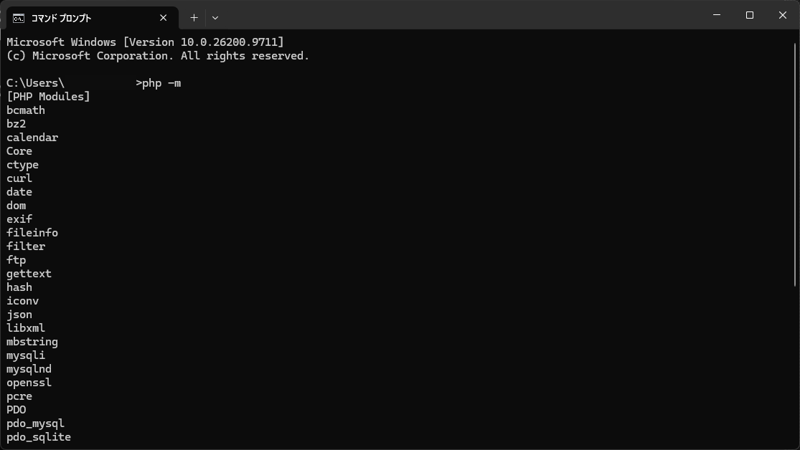

必要な拡張機能が一覧に含まれていることを確認する。

#### 手順2：設定ファイルを確認する

必要な拡張機能が表示されない場合は、PHPの設定ファイルを確認する。

設定ファイル：

`C:\xampp\php\php.ini`

`php.ini` は、PHPの動作設定を管理するファイルである。

#### 手順3：拡張機能を有効にする

例えば、以下のように記述されている場合がある。

```ini
;extension=intl
```

先頭の `;` はコメント記号であり、この状態では設定が無効になっている。<br>
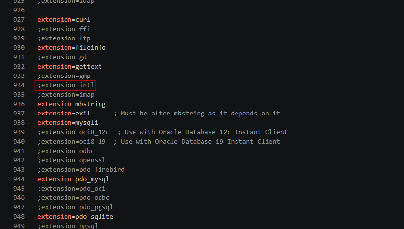

有効にする場合は、次のように変更する。

```ini
extension=intl
```

設定を保存したら、以下のコマンドで再確認する。

```cmd
php -m
```

一覧に対象の拡張機能が表示されれば、コマンドラインで使用するPHPの設定が有効になっている。<br>
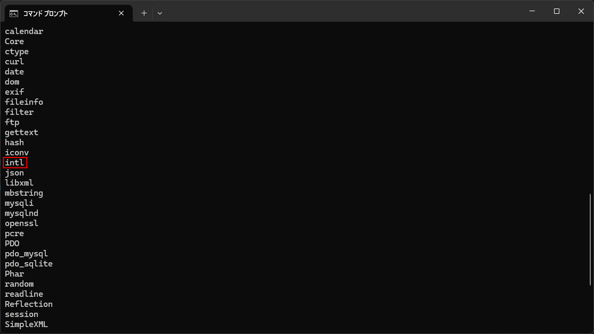

Apache経由で動作するPHPにも設定を反映させる場合は、XAMPP Control PanelからApacheを再起動する。

**注意：** `php.ini` はPHPの動作に関わる重要なファイルであるため、必要な項目だけ変更する。

### 4-5. PHPの動作確認

PHPの設定が完了したら、実際にプログラムを実行して正常に動作するか確認する。

#### 手順1：PHPのバージョンを確認する

コマンドプロンプトで以下を実行する。

```cmd
php -v
```

PHPのバージョンが表示されれば、PHPコマンドを使用できる。

#### 手順2：PHPプログラムを実行する

以下のコマンドを入力する。

```cmd
php -r "echo 'Hello PHP!';"
```

正常に実行されると、以下のように表示される。

```text
Hello PHP!
```

この結果が表示されれば、コマンドラインからPHPのプログラムを実行できる。<br>
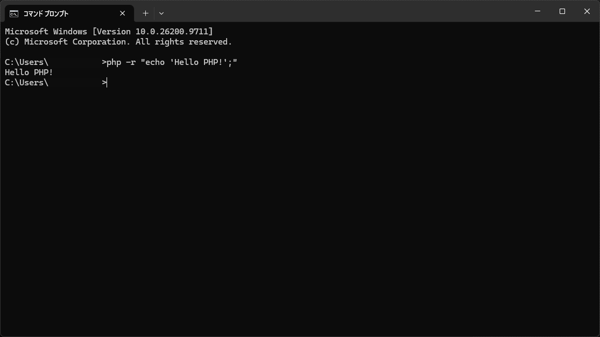

#### 手順3：Webサーバー経由でPHPを確認する

1. `C:\xampp\htdocs` を開く。
2. 新しいテキストファイルを作成する。
3. ファイル名を `php-test.php` に変更する。<br>
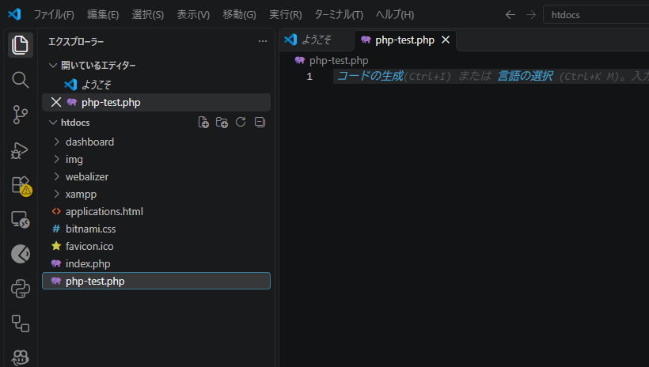

4. 以下のコードを入力して保存する。

```php
<?php
echo "Hello PHP!";
```

※ ファイル名が `php-test.php.txt` にならないように注意する。

XAMPP Control PanelからApacheを起動し、ブラウザで以下のURLにアクセスする。

`http://localhost/php-test.php`

正常に動作すると、以下の文字が表示される。

```text
Hello PHP!
```

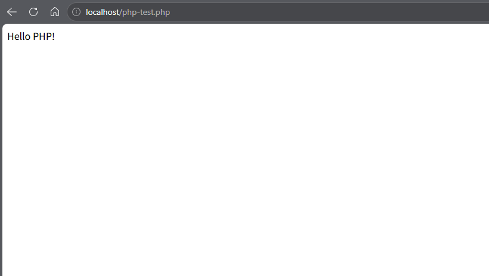

確認後は、テスト用に作成した `php-test.php` を削除してよい。