## 5. Composerの導入

CakePHPのプロジェクトを作成するために、PHPのライブラリ管理ツールであるComposerをインストールする。

### 5-1. Composerとは

Composer（コンポーザー）は、PHPのライブラリや依存関係を管理するためのツールである。

ライブラリとは、特定の機能をまとめた再利用可能なプログラムのことである。

また、依存関係とは、あるプログラムを動作させるために別のプログラムが必要になる関係のことである。

Composerを使用すると、必要なライブラリをまとめてインストールし、バージョンや依存関係を管理できる。

主に以下の操作に使用する。

- CakePHPのプロジェクトの作成
- PHPライブラリのインストール
- ライブラリのバージョン管理
- プロジェクトの依存関係の管理

今回は、CakePHPのプロジェクトを作成するためにComposerを導入する。

### 5-2. Composerのダウンロード

#### 手順1：公式サイトにアクセスする

Webブラウザを起動し、Composerの公式サイトにアクセスする。

公式サイト：https://getcomposer.org/

#### 手順2：ダウンロードページを開く

公式サイトの「Download」をクリックする。<br>
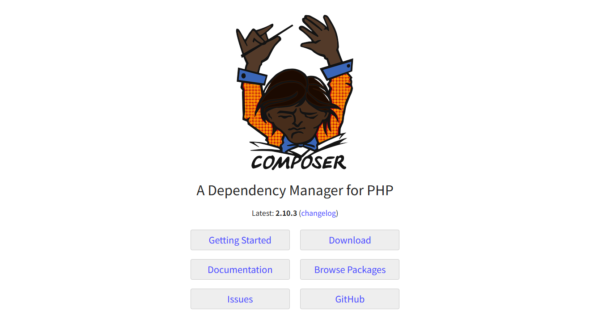

ダウンロードページ：https://getcomposer.org/download/

#### 手順3：Windows向けインストーラーを選択する

Windowsでは、専用のインストーラーを使用してComposerを導入できる。

ダウンロードページにある「Composer-Setup.exe」をクリックする。<br>
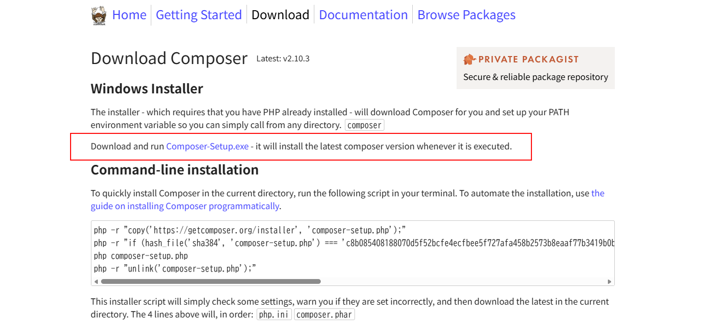

インストーラー：https://getcomposer.org/Composer-Setup.exe

#### 手順4：ダウンロードを確認する

ダウンロードが完了したら、エクスプローラーの「ダウンロード」フォルダーを開く。

以下のファイルが保存されていることを確認する。

`Composer-Setup.exe`

### 5-3. Composerのインストール

#### 手順1：インストール対象のユーザーを選択する

Composerのインストーラーを起動すると、「Select install mode」という画面が表示される。

この画面では、Composerを使用できるユーザーの範囲を選択する。

| 選択肢 | 内容 |
|---|---|
| Install for all users (recommended) | PCのすべてのユーザーが使用できる。管理者権限が必要 |
| Install for me only | 現在ログインしているユーザーのみが使用できる |

今回は「Install for all users (recommended)」を選択する。<br>
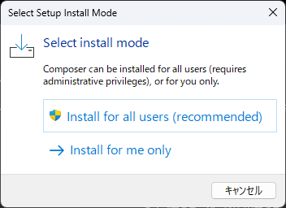

※ 管理者権限がない場合は、「Install for me only」を選択する。

選択後、次のインストール設定画面に進む。

#### 手順2：インストール方式を選択する

インストーラーのバージョンによっては、インストール方式やDeveloper Modeを選択する画面が表示される場合がある。

通常の開発環境では、Developer Modeを有効にする必要はない。<br>
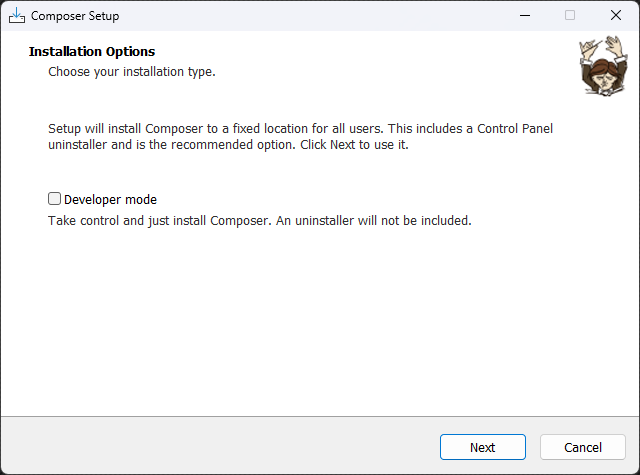

画面の案内に従い、「Next」をクリックする。

#### 手順3：PHPの実行ファイルを指定する

Composerが使用するPHPの実行ファイルを指定する。<br>
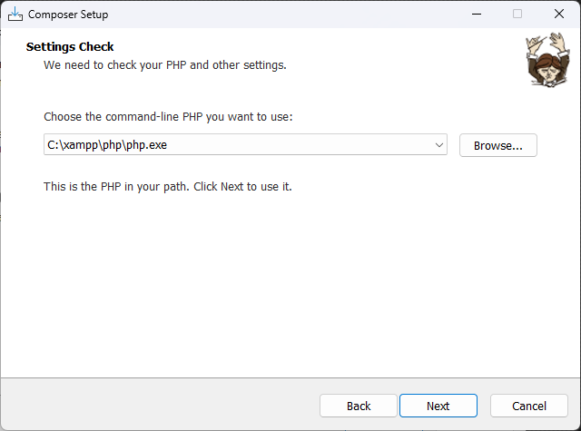

今回はXAMPPに含まれるPHPを使用するため、以下を指定する。

`C:\xampp\php\php.exe`

PHPの実行ファイルを指定したら、「Next」をクリックする。

**注意：** 別のPHPを指定すると、CakePHPで使用するPHPとバージョンが異なる可能性がある。

#### 手順4：プロキシ設定を確認する

ネットワーク環境によっては、プロキシ設定画面が表示される場合がある。

プロキシを使用していない場合は、基本的に設定を変更する必要はない。<br>
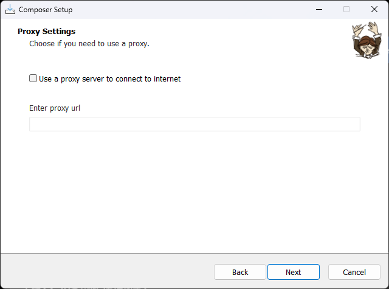

学校や企業のネットワークでプロキシが指定されている場合は、管理者の案内に従って設定する。

#### 手順5：インストール内容を確認する

インストール内容の確認画面が表示されたら、設定を確認する。

| 項目 | 設定 |
|---|---|
| PHPの実行ファイル | `C:\xampp\php\php.exe` |
| Composer | 2.x系 |
| プロキシ | 使用環境に合わせる |

問題がなければ「Install」をクリックする。<br>
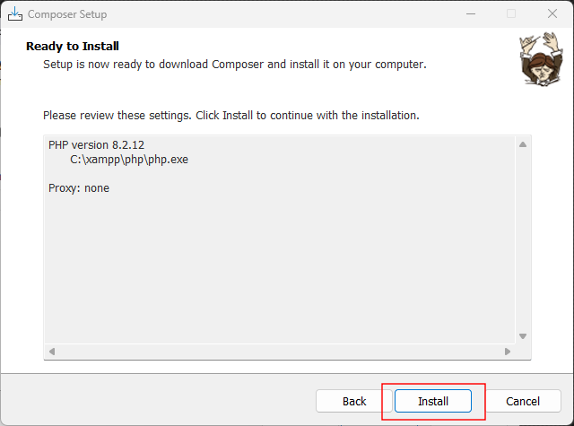

#### 手順6：インストールを完了する

インストールが完了するまで待つ。

#### 手順7：環境変数の変更に関する案内を確認する

「Information」画面が表示されたら、内容を確認する。<br>
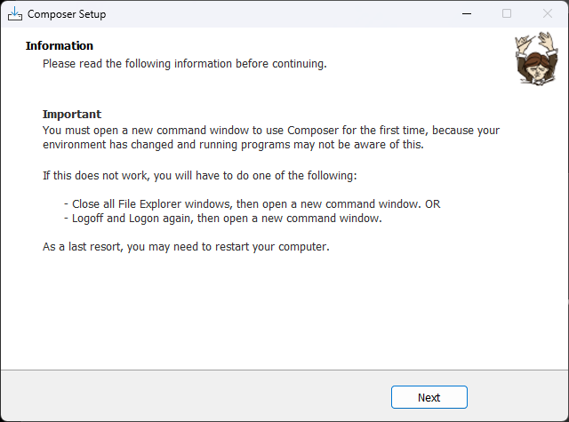

Composerのインストールによって環境変数が変更されるため、インストール後は新しいコマンドプロンプトを開く必要がある。

正常に動作しない場合は、Windowsへの再サインインやパソコンの再起動を行う。

内容を確認したら「Next」をクリックする。

完了画面が表示されたら「Finish」をクリックする。<br>
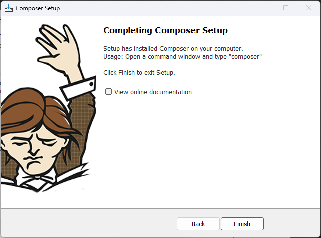

インストール完了後は、環境変数PATHの変更を反映するため、コマンドプロンプトを一度終了してから再起動する。

### 5-4. Composerの動作確認

Composerのインストールが完了したら、正常に動作するか確認する。

#### 手順1：コマンドプロンプトを起動する

1. Windowsのスタートメニューを開く。
2. 検索欄に `cmd` と入力する。
3. 「コマンドプロンプト」をクリックする。

※ インストール前から開いていたコマンドプロンプトは使用せず、新しく起動する。

#### 手順2：Composerのバージョンを確認する

以下のコマンドを入力する。

```cmd
composer --version
```

正常にインストールされていれば、Composerのバージョンが表示される。<br>
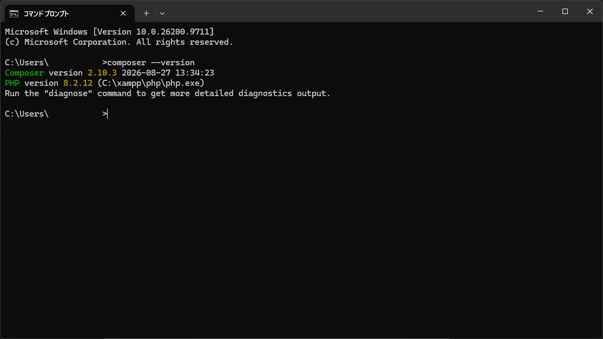

表示例：

```text
Composer version 2.x.x
```

※ 実際にはインストールされた具体的なバージョン番号が表示される。

#### 手順3：Composerの動作環境を確認する

以下のコマンドを入力する。

```cmd
composer diagnose
```

Composerの設定や通信環境などの診断結果が表示される。<br>
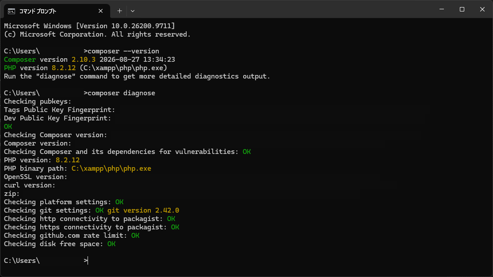

警告やエラーが表示された場合は、内容を確認して必要な設定を修正する。

#### 手順4：使用するPHPを確認する

以下のコマンドを入力する。

```cmd
php -v
```

続いて、PHPの実行ファイルの場所を確認する。

```cmd
where php
```

表示例：

```text
C:\xampp\php\php.exe
```

Composerの診断結果も確認し、開発で使用するPHPと異なる環境になっていないか確認する。