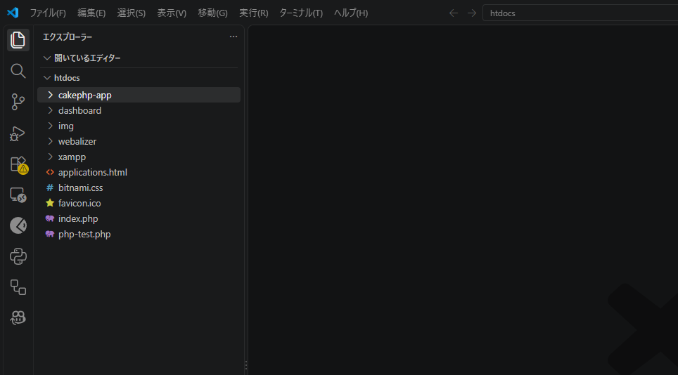
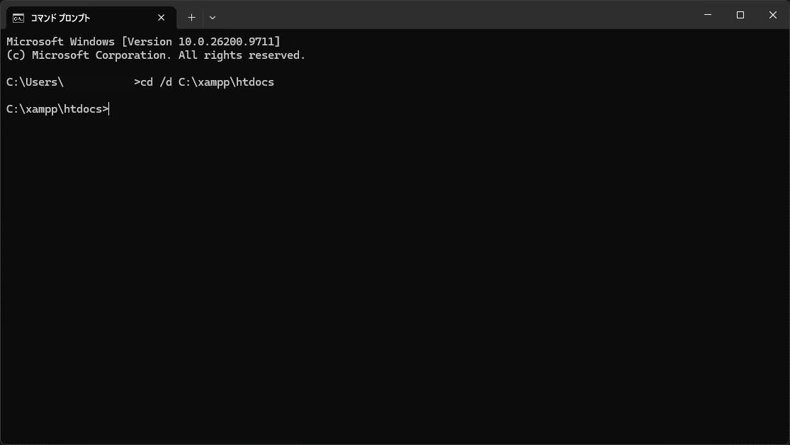
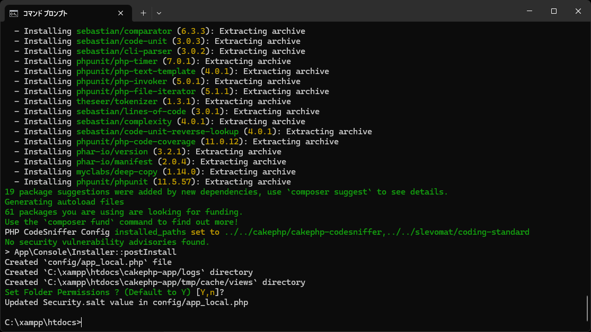
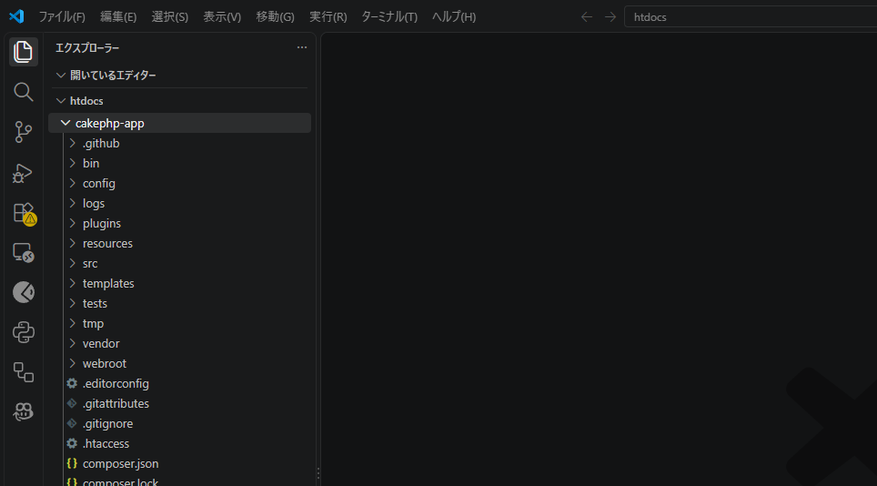
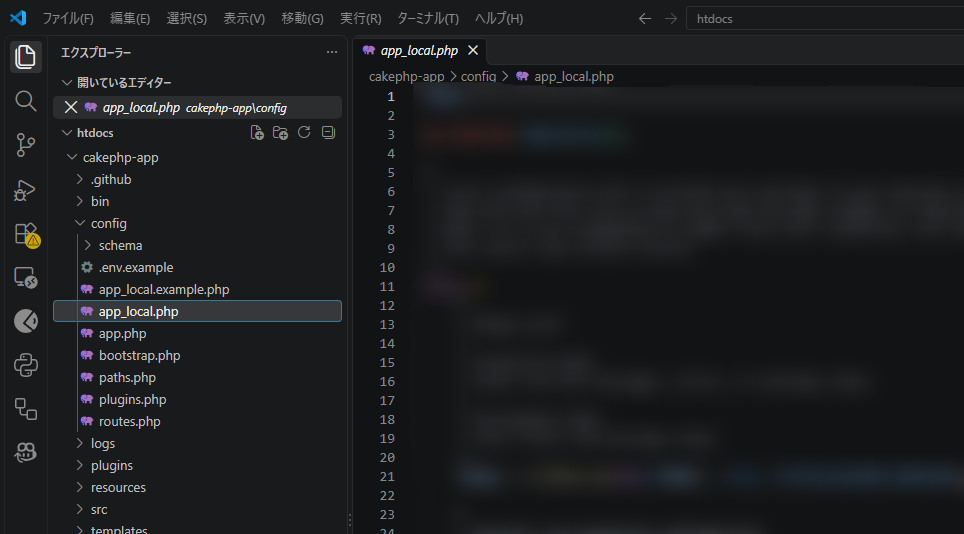
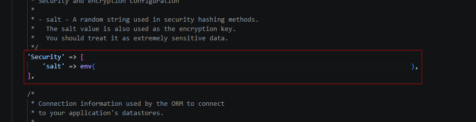

## 6. CakePHPの導入

Composerを使用してCakePHPのプロジェクトを作成し、フォルダー構成や初期設定を確認する。

### 6-1. CakePHPとは

CakePHPは、PHPでWebアプリケーションを効率よく開発するためのフレームワークである。

フレームワークとは、アプリケーション開発に必要な基本的な仕組みをまとめたものである。

CakePHPには、主に以下の機能が用意されている。

- データベースへの接続・操作
- URLと処理の対応付け
- 画面表示の仕組み
- 入力データの検証
- セキュリティ対策を支援する機能

CakePHPはMVC（Model・View・Controller）という設計パターンを採用している。

| 要素 | 役割 |
|---|---|
| Model | データの取得・保存などを担当する |
| View | 画面の表示を担当する |
| Controller | リクエストに応じた処理を制御する |

### 6-2. プロジェクトの保存先を決める

今回は、XAMPPの `htdocs` フォルダー内にCakePHPのプロジェクトを作成する。

保存先：

`C:\xampp\htdocs`

`htdocs` は、ApacheがWebページを公開するために使用する標準のフォルダーである。

今回はプロジェクト名を `cakephp-app` とする。

作成後の保存先：

`C:\xampp\htdocs\cakephp-app`

※ CakePHPは必ず `htdocs` に保存する必要があるわけではない。今回は保存場所を統一するため、このフォルダーを使用する。<br>


### 6-3. CakePHPプロジェクトの作成

#### 手順1：コマンドプロンプトを起動する

1. Windowsのスタートメニューを開く。
2. 検索欄に `cmd` と入力する。
3. 「コマンドプロンプト」をクリックする。

#### 手順2：保存先に移動する

以下のコマンドを入力する。

```cmd
cd /d C:\xampp\htdocs
```

実行後、以下のように表示されれば成功となる。<br>


```text
C:\xampp\htdocs>
```

#### 手順3：CakePHPのプロジェクトを作成する

以下のコマンドを実行する。

```cmd
cd /d C:\xampp\htdocs\cakephp-app
composer require "cakephp/cakephp:5.4.3" --with-all-dependencies
```

コマンドの意味は以下のとおり。

| 部分 | 意味 |
|---|---|
| `composer` | Composerを実行する |
| `create-project` | 新しいプロジェクトを作成する |
| `--prefer-dist` | 配布用パッケージを優先する |
| `cakephp/app:"5.4.0"` | CakePHPアプリケーションテンプレートの5.4.0を指定する |
| `cakephp-app` | 作成するフォルダー名 |

※ `cakephp/app` はCakePHPアプリケーションのひな形であり、必要なパッケージはComposerが依存関係を解決して導入する。

##### エラーが発生した場合

コマンド実行後、以下のエラーが表示される場合がある。

```text
Failed to download cakephp/app from dist:
The zip extension and unzip/7z commands are both missing, skipping.
```

このエラーは、PHPのZIP拡張機能が有効になっておらず、ZIPファイルを展開するための外部コマンドも見つからない場合に発生する。

**対処方法（4-4. PHP拡張機能の確認と同じ内容）**

1. `C:\xampp\php\php.ini` をメモ帳やVS Codeで開く。
2. `Ctrl + F` で `;extension=zip` を検索する。
3. 行の先頭にある `;` を削除する。
4. `Ctrl + S` で保存する。

変更前：

```ini
;extension=zip
```

変更後：

```ini
extension=zip
```

設定を保存したら、コマンドプロンプトで以下を実行する。

```cmd
php -m
```

表示される拡張機能の一覧に `zip` が含まれていれば、ZIP拡張機能が有効になっている。

続いて、以下のコマンドで再度CakePHPのプロジェクトを作成する。

```cmd
cd /d C:\xampp\htdocs
composer create-project --prefer-dist cakephp/app:"5.4.0" cakephp-app
```

**注意：** インストール失敗時に `C:\xampp\htdocs\cakephp-app` フォルダーが作成されている場合は、再実行前に確認する。

今回の失敗によって作成されたフォルダーであり、必要なファイルが保存されていない場合に限り、フォルダーを削除してから再実行する。

※ すでに作業中のプロジェクトが存在する場合は、削除しないこと。

#### 手順4：インストール完了まで待つ

Composerが必要なファイルやライブラリをダウンロードする。

インストール中に質問が表示された場合は、内容を確認してから回答する。

エラーが発生せず、コマンド入力待ちの状態に戻ったら次へ進む。

#### 手順5：フォルダーのアクセス権限を設定する

インストール中に、以下の確認メッセージが表示される場合がある。

```text
Set Folder Permissions ? (Default to Y) [Y,n]?
```

これは、CakePHPが使用するフォルダーのアクセス権限を設定するか確認するメッセージである。

| 入力 | 内容 |
|---|---|
| Y | アクセス権限を設定する |
| n | アクセス権限を設定しない |
| Enterのみ | 初期値のYを選択する |

今回は初期値の「Y」を使用するため、何も入力せずにEnterキーを押す。<br>


CakePHPでは、ログやキャッシュなどを保存するため、対象フォルダーに書き込み権限が必要となる。

設定が完了し、コマンド入力待ちの状態に戻れば、プロジェクトの作成は完了となる。

#### 手順6：フォルダーを確認する

エクスプローラーで以下の場所を開く。

`C:\xampp\htdocs\cakephp-app`

`src`、`config`、`templates`、`webroot` などのフォルダーが作成されていることを確認する。<br>


#### 手順7：CakePHP本体を5.4.3に固定する

`cakephp/app` はひな形のバージョンであり、CakePHP本体とは別である。プロジェクト作成後に以下を実行し、本体を5.4.3に固定する。

```cmd
cd /d C:\xampp\htdocs\cakephp-app
composer require cakephp/cakephp:5.4.3 --with-all-dependencies
composer show cakephp/cakephp
composer check-platform-reqs
```

`versions` に `5.4.3` が表示され、実行環境の要件チェックが成功することを確認する。

`composer.json` と `composer.lock` をチームで共有し、他のPCでは `composer install` を実行する。

### 6-4. プロジェクトのフォルダー構成を確認する

CakePHPのプロジェクトには、最初から複数のフォルダーやファイルが用意されている。

主なフォルダーとファイルは以下のとおり。

| フォルダー・ファイル | 役割 |
|---|---|
| bin | CakePHPのコマンド |
| config | アプリケーションの設定 |
| plugins | プラグイン |
| src | アプリケーションの処理 |
| templates | 画面のテンプレート |
| tests | テストコード |
| tmp | 一時ファイル |
| vendor | Composerが管理するライブラリ |
| webroot | 公開用のファイル |
| composer.json | 依存パッケージの定義 |

MVCに関係する主なフォルダーは以下のとおり。

| 役割 | 主な保存先 |
|---|---|
| Model | `src/Model/` |
| View | `templates/` |
| Controller | `src/Controller/` |

`webroot` にはCSS・JavaScript・画像などの公開用ファイルを保存する。

`vendor` はComposerが管理するライブラリを保存する場所であり、原則として直接編集しない。

### 6-5. CakePHPの初期設定を確認する

#### 手順1：プロジェクトフォルダーへ移動する

コマンドプロンプトで以下のコマンドを実行する。

```cmd
cd /d C:\xampp\htdocs\cakephp-app
```

#### 手順2：設定ファイルを確認する

エクスプローラーで以下のファイルを確認する。

`C:\xampp\htdocs\cakephp-app\config\app_local.php`

`app_local.php` は、データベース接続など、開発環境ごとの設定を記述するファイルである。<br>


ファイルが存在しない場合は、インストール時のメッセージを確認する。

#### 手順3：アプリケーションキーを確認する

`config/app_local.php` の `Security` にある `salt` 設定を確認する。

記述例：

```php
'Security' => [
    'salt' => 'ランダムに生成された文字列',
],
```

この値はセキュリティに関係する重要な設定である。<br>


**注意：** 実際の値を公開したり、公開リポジトリに登録したりしないこと。

#### 手順4：CakePHPのコマンドを確認する

プロジェクトフォルダーで以下のコマンドを実行する。

```cmd
php bin\cake.php --help
```

CakePHPのコマンド一覧やヘルプが表示されれば、CakePHPのコマンドラインツールが正常に動作していることを確認できる。

※ データベース接続の設定は、ステップ8「データベースの設定」で行う。

### 6-4. 既存のCakePHPを5.4.3にアップデートする

**バージョンが5.4.3の人はこの工程はスキップしてください。**

すでにCakePHP 5.2系をインストールしている場合は、プロジェクトを新しく作り直す必要はない。

Composerを使用して、既存のプロジェクトをCakePHP 5.4.3にアップデートする。

**注意：** この手順は、すでにCakePHPのプロジェクトが作成されている人向けである。新規インストールを行った場合は、この項目を省略する。

#### 手順1：プロジェクトをバックアップする

アップデートによって、CakePHP本体や依存ライブラリが変更される。

作業前にプロジェクトフォルダーをバックアップするか、Gitで現在の変更内容をコミットしておく。

今回のプロジェクトフォルダー：

`C:\xampp\htdocs\cakephp-app`

※ アップデートによって既存の設定ファイルが自動的にすべて更新されるわけではない。

#### 手順2：コマンドプロンプトを起動する

1. Windowsのスタートメニューを開く。
2. 検索欄に `cmd` と入力する。
3. 「コマンドプロンプト」をクリックする。

#### 手順3：プロジェクトフォルダーへ移動する

以下のコマンドを実行する。

```cmd
cd /d C:\xampp\htdocs\cakephp-app
```

#### 手順4：現在のCakePHPのバージョンを確認する

以下のコマンドを実行する。

```cmd
composer show cakephp/cakephp
```

`versions` に現在インストールされているCakePHP本体のバージョンが表示される。

表示例：

```text
versions : * 5.2.15
```

※ バージョン番号は環境によって異なる。

#### 手順5：CakePHP本体を5.4.3にアップデートする

以下のコマンドを実行する。

```cmd
composer require "cakephp/cakephp:5.4.3" --with-all-dependencies
```

このコマンドでは、CakePHP本体のバージョンを5.4.3に指定し、必要な依存パッケージも更新する。

| コマンドの部分 | 意味 |
|---|---|
| `composer` | Composerを実行する |
| `require` | プロジェクトで使用するパッケージを指定する |
| `cakephp/cakephp:5.4.3` | CakePHP本体を5.4.3に固定する |
| `--with-all-dependencies` | 関連する依存パッケージの更新も許可する |

Composerが依存関係を確認し、必要なパッケージをダウンロード・更新する。

処理が完了し、コマンド入力待ちの状態に戻るまで待つ。

※ エラーが発生した場合は、エラーメッセージを確認する。依存パッケージの互換性によっては、追加の対応が必要となる場合がある。

#### 手順6：アップデート後のバージョンを確認する

以下のコマンドを実行する。

```cmd
composer show cakephp/cakephp
```

次のように表示されれば、CakePHP本体の更新が完了している。

```text
versions : * 5.4.3
```

#### 手順7：PHPの動作要件を確認する

以下のコマンドを実行する。

```cmd
composer check-platform-reqs
```

PHPのバージョンや拡張機能などが、インストールされたパッケージの動作要件を満たしているか確認する。

エラーが表示された場合は、不足しているPHP拡張機能やバージョンを確認する。

#### 手順8：CakePHPの動作を確認する

以下のコマンドで開発サーバーを起動する。

```cmd
php bin\cake.php server
```

ブラウザで以下のURLにアクセスする。

`http://localhost:8765/`

CakePHPの初期画面が正常に表示されることを確認する。

データベースを設定済みの場合は、データベース接続も正常であることを確認する。

動作確認が完了したら、コマンドプロンプトで `Ctrl + C` を押して開発サーバーを停止する。

#### 手順9：アップデート後の変更を保存する

アップデートにより、主に以下のファイルが変更される。

- `composer.json`：使用するパッケージとバージョンの定義
- `composer.lock`：実際にインストールする依存パッケージのバージョン情報

チーム開発では、これらのファイルをGitで管理し、変更内容を共有する。

他の開発メンバーは、更新されたファイルを取得した後、プロジェクトフォルダーで以下を実行する。

```cmd
composer install
```

これにより、`composer.lock` に記録された依存パッケージがインストールされる。

**注意：** CakePHP本体の更新だけでは、古いアプリケーションの設定ファイルやコードが自動的に新しい仕様へ変更されるわけではない。5.3および5.4の移行ガイドを確認し、必要な修正を行う。

以上で、既存のCakePHPを5.4.3にアップデートする作業は完了となる。
