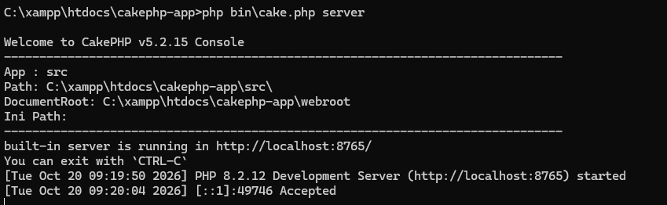
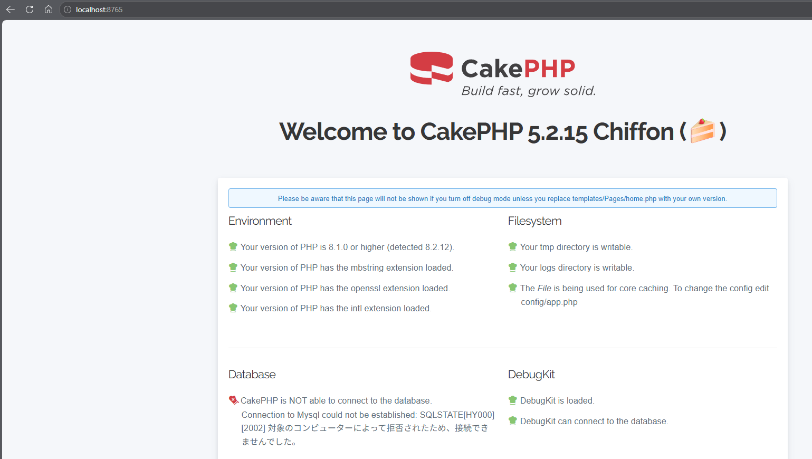
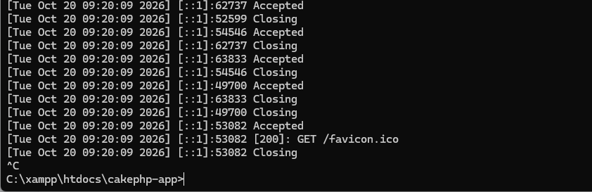
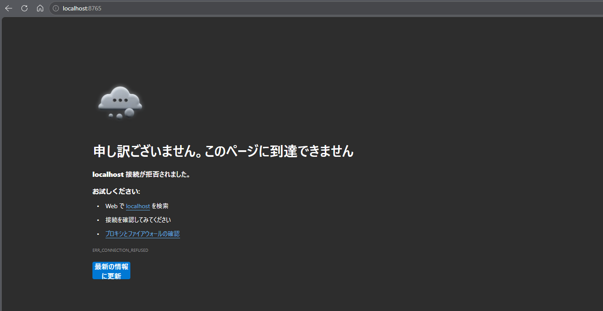

## 7. CakePHPの動作確認

CakePHPのプロジェクト作成が完了したら、開発サーバーを起動し、ブラウザから初期画面が表示されるか確認する。

### 7-1. CakePHPの開発サーバーとは

CakePHPには、開発中のWebアプリケーションをブラウザで確認するための開発サーバー機能がある。

この機能を使用すると、XAMPPのApacheを起動しなくてもCakePHPの動作確認ができる。

| 項目 | XAMPPのApache | CakePHPの開発サーバー |
|---|---|---|
| 主な用途 | Webサーバーとしての動作 | 開発中の動作確認 |
| 起動方法 | XAMPP Control Panel | コマンド |
| アクセス先の例 | `http://localhost/` | `http://localhost:8765/` |
| Apacheの起動 | 必要 | 不要 |

今回はCakePHPの開発サーバーを使用する。

※ CakePHPの開発サーバーは開発・動作確認用であり、本番環境の公開には使用しない。

### 7-2. プロジェクトフォルダーへ移動する

#### 手順1：コマンドプロンプトを起動する

1. Windowsのスタートメニューを開く。
2. 検索欄に `cmd` と入力する。
3. 「コマンドプロンプト」をクリックする。

ステップ6で使用したコマンドプロンプトが開いている場合は、そのまま使用してもよい。

#### 手順2：プロジェクトフォルダーへ移動する

以下のコマンドを入力する。

```cmd
cd /d C:\xampp\htdocs\cakephp-app
```

Enterキーを押す。

正常に移動できると、次のように表示される。

```text
C:\xampp\htdocs\cakephp-app>
```



### 7-3. CakePHPの開発サーバーを起動する

#### 手順1：起動コマンドを入力する

以下のコマンドを実行する。

```cmd
php bin\cake.php server
```

コマンドの意味は以下のとおり。

| 部分 | 意味 |
|---|---|
| php | PHPを実行する |
| bin\cake.php | CakePHPのコマンドラインツール |
| server | 開発サーバーを起動する |

#### 手順2：起動結果を確認する

正常に起動すると、開発サーバーのアドレスなどが表示される。

通常は、以下のアドレスでアクセスできる。

`http://localhost:8765/`

※ 表示内容はCakePHPのバージョンによって異なる場合がある。

**注意：** 開発サーバーを使用している間は、コマンドプロンプトを閉じないこと。

### 7-4. ブラウザで初期画面を確認する

#### 手順1：Webブラウザを起動する

Microsoft EdgeやGoogle Chromeなどを起動する。

#### 手順2：URLを入力する

アドレスバーに以下のURLを入力する。

`http://localhost:8765/`

#### 手順3：CakePHPの初期画面を確認する

CakePHPの初期画面が表示されれば、Webアプリケーションが起動していることを確認できる。<br>


初期画面には、PHPの動作環境やCakePHPの設定に関する確認結果が表示される場合がある。

なお、データベースに関する警告や接続エラーが表示される場合がある。

今回はまだデータベース接続の設定を行っていないため、データベースの接続確認は次のステップ8で行う。

### 7-5. 開発サーバーの停止と再起動

#### 手順1：開発サーバーを停止する

開発サーバーを起動しているコマンドプロンプトを選択する。

キーボードで `Ctrl + C` を押す。<br>


#### 手順2：停止を確認する

コマンドプロンプトが入力待ちの状態に戻ったことを確認する。

その後、ブラウザで `http://localhost:8765/` を再読み込みする。

他のサーバーが同じポートで起動していなければ、ページに接続できなくなる。<br>


#### 手順3：開発サーバーを再起動する

以下のコマンドを実行する。

```cmd
php bin\cake.php server
```

ブラウザから再び `http://localhost:8765/` にアクセスし、CakePHPの初期画面が表示されることを確認する。