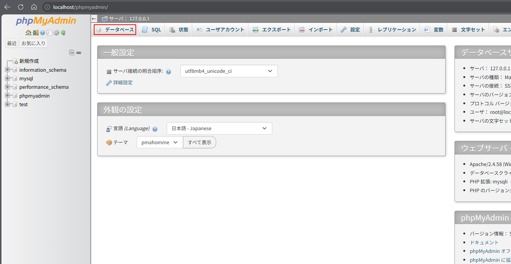
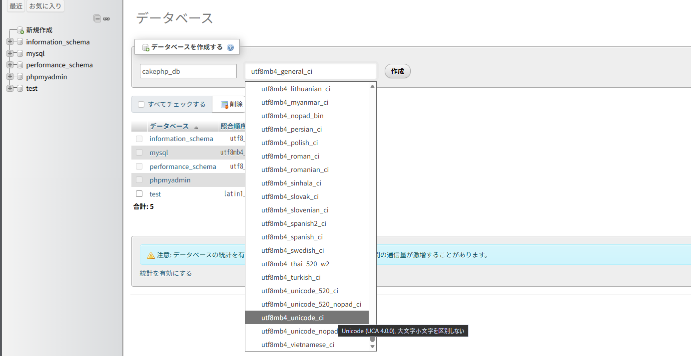
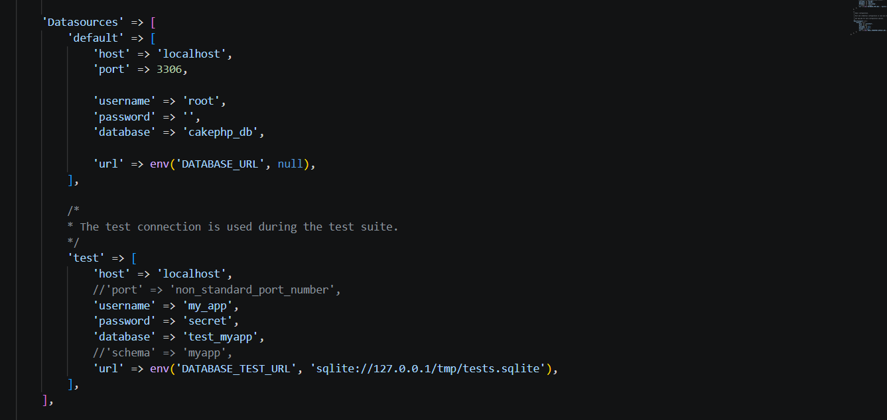
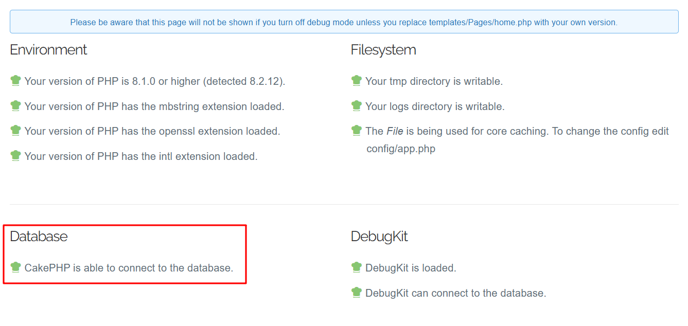

## 8. データベースの設定

XAMPPに含まれるMySQL（MariaDB）を使用してデータベースを作成し、CakePHPから接続できるように設定する。

### 8-1. データベースとは

データベースとは、情報を整理して保存・管理するための仕組みである。

CakePHPは、データベースに接続することで、情報の取得・登録・更新・削除を行うことができる。

今回は以下の環境を使用する。

| 項目 | 内容 |
|---|---|
| データベース管理システム | MariaDB（XAMPPではMySQLとして表示） |
| 管理ツール | phpMyAdmin |
| データベース名 | `cakephp_db` |
| 接続先 | `localhost` |
| ポート番号 | `3306`（標準設定） |

### 8-2. MySQL（MariaDB）の起動

#### 手順1：XAMPP Control Panelを開く

以下のファイルをダブルクリックする。

`C:\xampp\xampp-control.exe`

#### 手順2：ApacheとMySQLを起動する

XAMPP Control Panelで、ApacheとMySQLの「Start」をクリックする。

両方の行が緑色になり、「Start」が「Stop」に変われば起動成功となる。

ApacheはphpMyAdminをブラウザで表示するために使用し、MySQLはデータベースを管理するために使用する。

### 8-3. データベースの作成

#### 手順1：phpMyAdminを開く

ブラウザで以下のURLにアクセスする。

`http://localhost/phpmyadmin/`

#### 手順2：「データベース」をクリックする

phpMyAdminの画面上部にある「データベース」タブをクリックする。<br>


#### 手順3：データベース名を入力する

「データベースを作成する」という項目に、以下を入力する。

`cakephp_db`

照合順序は、利用できる場合は `utf8mb4_unicode_ci` を選択する。<br>


照合順序とは、文字列を比較したり並び替えたりする際のルールのことである。

`utf8mb4` は、日本語や絵文字などを扱える文字コードの設定である。

#### 手順4：「作成」をクリックする

データベース名と照合順序を確認し、「作成」をクリックする。

左側のデータベース一覧に `cakephp_db` が表示されれば成功となる。

この段階では、テーブルを作成する必要はない。

### 8-4. CakePHPのデータベース接続設定

#### 手順1：設定ファイルを開く

以下のファイルをVS Codeやメモ帳などで開く。

`C:\xampp\htdocs\cakephp-app\config\app_local.php`

#### 手順2：Datasourcesの設定を探す

ファイル内にある `Datasources` の設定を探す。

その中の `default` が、CakePHPで標準的に使用するデータベース接続設定である。

#### 手順3：接続情報を設定する

今回は、XAMPPの初期設定で `root` ユーザーにパスワードが設定されていない場合を例とする。

| 項目 | 設定値 |
|---|---|
| host | `localhost` |
| port | `3306` |
| username | `root` |
| password | `''`（空文字列） |
| database | `cakephp_db` |
| encoding | `utf8mb4` |

`Datasources` の `default` にある対応する項目を以下のように設定する。

```php

'Datasources' => [
    'default' => [
        'host' => 'localhost',
        'port' => 3306,

        'username' => 'root',
        'password' => '',
        'database' => 'cakephp_db',

        'url' => env('DATABASE_URL', null),
    ],

    /*
     * The test connection is used during the test suite.
     */
    'test' => [
        'host' => 'localhost',
        //'port' => 'non_standard_port_number',
        'username' => 'my_app',
        'password' => 'secret',
        'database' => 'test_myapp',
        //'schema' => 'myapp',
        'url' => env('DATABASE_TEST_URL', 'sqlite://127.0.0.1/tmp/tests.sqlite'),
    ],
],

```



※ 上記は接続情報を説明するための抜粋である。実際には既存の `Datasources` 設定全体を削除せず、必要な値だけ変更する。

`driver` や `url` など、元から存在する設定も確認する。

特に `url` に接続先が設定されている場合は、個別の設定値より優先されることがある。

**注意：** `root` ユーザーにパスワードが設定されている場合は、そのパスワードを入力する。

パスワードなしの `root` ユーザーは学習用のローカル環境に限定し、外部公開する環境では使用しない。

#### 手順4：設定ファイルを保存する

変更が完了したら、`Ctrl + S` で保存する。

設定ファイルには機密情報が含まれる場合があるため、公開リポジトリには登録しない。

### 8-5. データベースの接続確認

#### 手順1：CakePHPの開発サーバーを起動する

コマンドプロンプトで以下を実行する。

```cmd
cd /d C:\xampp\htdocs\cakephp-app
```

続いて、開発サーバーを起動する。

```cmd
php bin\cake.php server
```

すでに開発サーバーが起動している場合は、そのまま利用できる。設定変更が反映されない場合は再起動する。

#### 手順2：ブラウザからアクセスする

以下のURLにアクセスする。

`http://localhost:8765/`

#### 手順3：データベースの接続状態を確認する

CakePHPの初期画面に表示されるデータベース接続の確認結果を見る。<br>


データベースへの接続が成功していることを示すメッセージが表示されれば正常となる。

接続に失敗した場合は、以下の項目を確認する。

| 確認項目 | 内容 |
|---|---|
| MySQL | XAMPPで起動しているか |
| データベース名 | `cakephp_db` が存在するか |
| ユーザー名 | 正しいユーザーを指定しているか |
| パスワード | 設定したパスワードと一致しているか |
| ポート番号 | 実際の接続先ポートと一致しているか |
| PHP拡張機能 | `pdo_mysql` が有効になっているか |