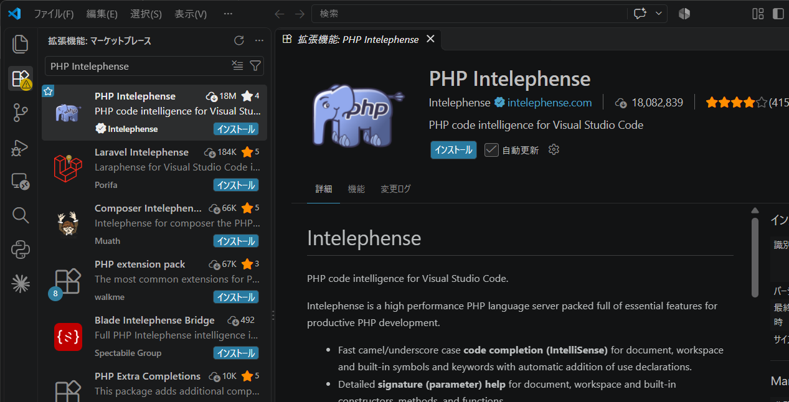
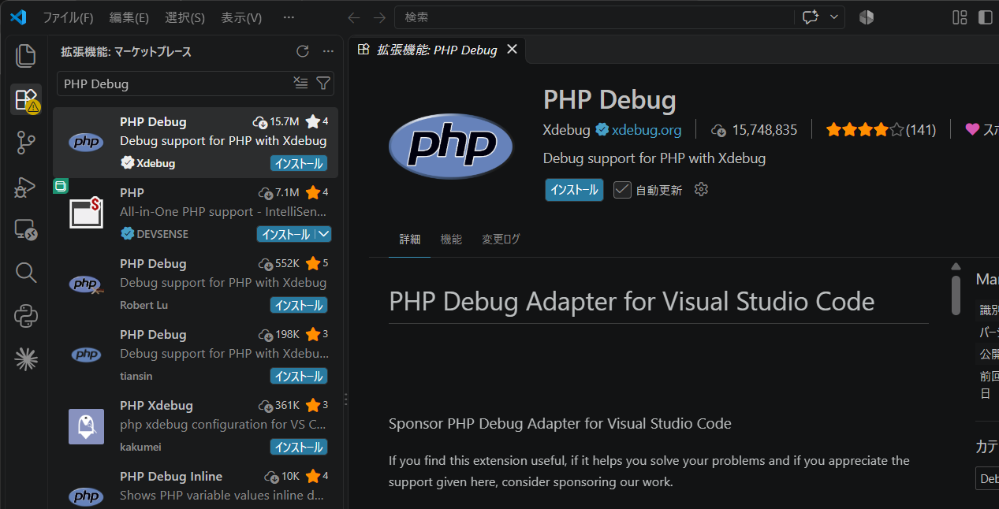
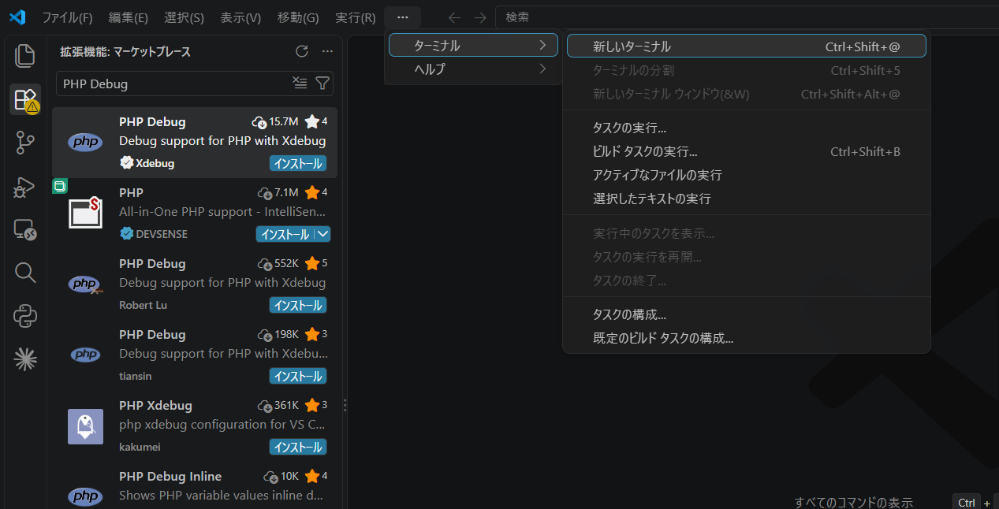
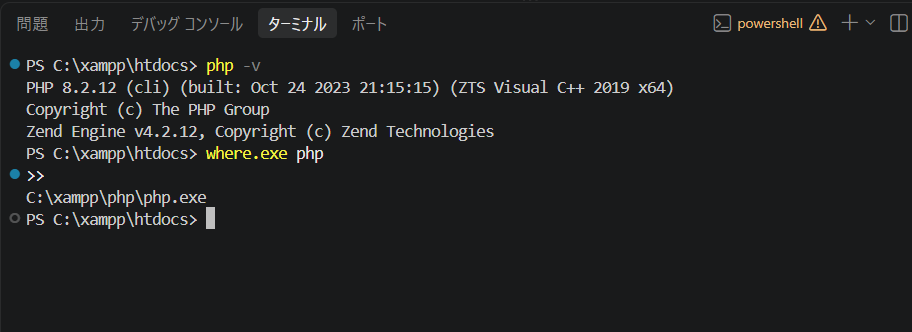

## 9. VS Codeの設定

このステップでは、インストール済みのVisual Studio Code（VS Code）を使用して、CakePHPの開発環境を整える。

※ VS Codeはすでにインストールされているものとする。

### 9-1. CakePHPのプロジェクトを開く

#### 手順1：VS Codeを起動する

WindowsのスタートメニューなどからVS Codeを起動する。

#### 手順2：フォルダーを開く

画面上部のメニューから、以下を選択する。

**「ファイル」→「フォルダーを開く」**

#### 手順3：プロジェクトフォルダーを選択する

以下のフォルダーを指定する。

```text
C:\xampp\htdocs\cakephp-app
```

「フォルダーの選択」をクリックする。

フォルダーの信頼に関する確認画面が表示された場合は、内容を確認し、自分で作成したプロジェクトであれば「はい、作成者を信頼します」を選択する。

#### 手順4：ファイル一覧を確認する

画面左側のエクスプローラーにCakePHPのフォルダーやファイルが表示されることを確認する。

主なフォルダーは以下のとおり。

| フォルダー | 用途 |
|---|---|
| `src/` | PHPのアプリケーション処理 |
| `templates/` | 画面表示用のテンプレート |
| `config/` | CakePHPの設定 |
| `webroot/` | CSS・JavaScript・画像など |
| `vendor/` | Composerが管理するライブラリ |

※ `vendor/` 内のファイルは、基本的に直接編集しない。

### 9-2. PHP開発用の拡張機能を導入する

VS Codeには、開発を補助する拡張機能がある。

今回は以下の拡張機能を導入する。

| 拡張機能 | 用途 |
|---|---|
| PHP Intelephense | PHPの入力補完・コード解析など |
| PHP Debug | PHPのデバッグ支援 |

#### 手順1：拡張機能を開く

画面左側の拡張機能アイコンをクリックする。

ショートカットキー：`Ctrl + Shift + X`

#### 手順2：拡張機能を検索する

検索欄に `PHP Intelephense` と入力する。<br>


#### 手順3：インストールする

提供元が `Ben Mewburn` であることを確認し、「インストール」をクリックする。

PHP Intelephense：

https://marketplace.visualstudio.com/items?itemName=bmewburn.vscode-intelephense-client

必要に応じて `PHP Debug` もインストールする。<br>


PHP Debug：

https://marketplace.visualstudio.com/items?itemName=xdebug.php-debug

※ PHP Debugでブレークポイントなどを使用するには、別途Xdebugの設定が必要となる。

### 9-3. PHPの実行環境を確認する

#### 手順1：VS Codeのターミナルを開く

画面上部のメニューから、以下を選択する。

**「ターミナル」→「新しいターミナル」**<br>


#### 手順2：PHPのバージョンを確認する

以下のコマンドを実行する。

```powershell
php -v
```

PHPのバージョン情報が表示されれば、VS CodeのターミナルからPHPを実行できる。

#### 手順3：使用しているPHPの場所を確認する

以下のコマンドを実行する。

```powershell
where.exe php
```

実行結果に以下のパスが表示されることを確認する。

```text
C:\xampp\php\php.exe
```



※ 複数のPHPがインストールされている場合は、複数のパスが表示されることがある。使用するPHPがXAMPPのものであることを確認する。

### 9-4. VS CodeのターミナルでCakePHPを起動する

#### 手順1：現在のフォルダーを確認する

ターミナルに以下のような表示があることを確認する。

```powershell
PS C:\xampp\htdocs\cakephp-app>
```

別のフォルダーが表示されている場合は、以下のコマンドで移動する。

```powershell
cd C:\xampp\htdocs\cakephp-app
```

#### 手順2：開発サーバーを起動する

以下のコマンドを実行する。

```powershell
php bin\cake.php server
```

正常に起動すると、開発サーバーのアドレスなどが表示される。

※ すでに別のターミナルで開発サーバーが起動している場合は、先に停止する。

### 9-5. ブラウザで動作確認する

#### 手順1：ブラウザを開く

Microsoft EdgeやGoogle Chromeなどを起動する。

#### 手順2：CakePHPにアクセスする

以下のURLにアクセスする。

`http://localhost:8765/`

#### 手順3：初期画面を確認する

CakePHPの初期画面が表示されることを確認する。

PHPの動作環境やデータベース接続に関する確認結果が正常であれば、開発環境の設定は完了となる。

#### 手順4：開発サーバーを停止する

VS Codeのターミナルで `Ctrl + C` を押す。